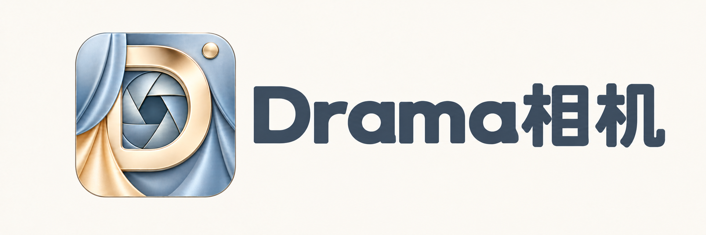
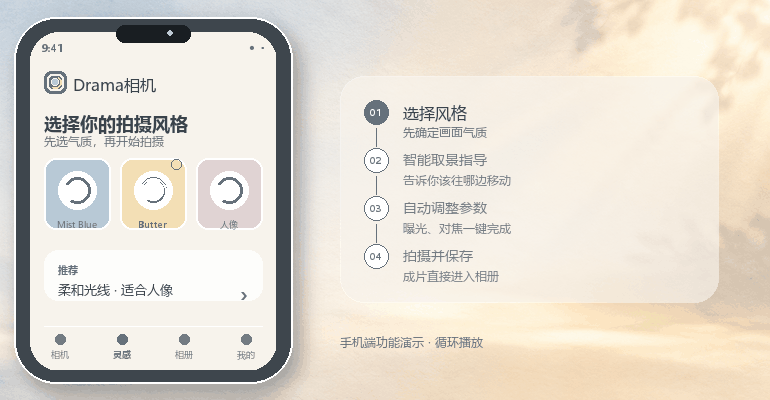
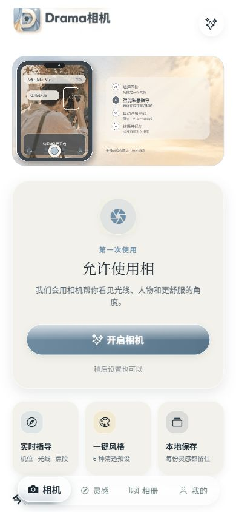
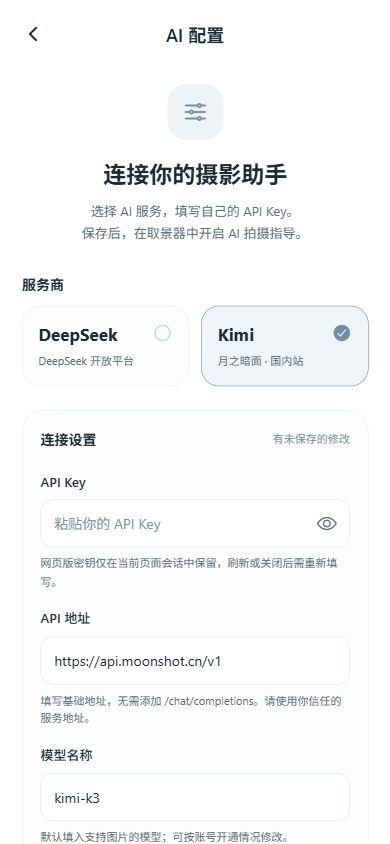
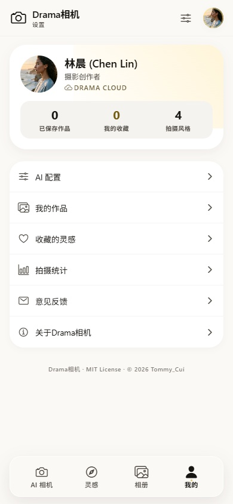
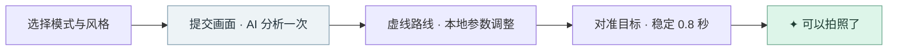

<div align="center">



# Drama 相机

### 把「怎么拍」变成看得见的下一步。

用 AI 看懂当前画面，用虚线引导调整构图。<br />
对准目标、稳住手机，等一句清晰的「可以拍照了」。


[界面预览](#-界面预览) · [App 内使用](#-app-内使用) · [运行项目](#-运行项目)

</div>

---

Drama 是一个基于 **Expo + React Native** 的 AI 摄影指导应用，优先面向 Android。选择拍摄模式与风格，将当前取景画面交给视觉模型；模型返回结构化方案，手机负责显示路线、执行支持的参数，并在本地判断是否完成调整。

**一次请求，一步调整，本地完成。** 不持续上传视频，不按固定间隔轮询模型；需要新方案时，再点击「重新规划」。

---

## 📸 界面预览

### 功能演示

<div align="center">

<p><sub>手机端功能演示 · 循环播放</sub></p>
</div>

### 核心页面

<table>
  <tr>
    <th align="center">🎥 拍摄首页</th>
    <th align="center">⚙️ AI 配置</th>
    <th align="center">👤 个人页面</th>
  </tr>
  <tr>
    <td align="center"></td>
    <td align="center"></td>
    <td align="center"></td>
  </tr>
  <tr>
    <td align="center"><sub>选择模式与风格，开启相机权限</sub></td>
    <td align="center"><sub>选择服务商，填写 API Key</sub></td>
    <td align="center"><sub>个人中心与 AI 配置入口</sub></td>
  </tr>
</table>

> 截图来自当前代码的 Web 预览，使用移动端尺寸；未填写真实密钥。Android 的权限提示、系统栏和原生相机表现会有所不同。

### 功能亮点

| 功能 | 使用体验 |
| :--- | :--- |
| **看得见的移动路线** | 取景器显示中心点、虚线和目标圈，按提示调整手机，让中心点与目标圈重合。文字和操作控件位于取景框外。 |
| **到位即提示可拍** | 位置满足要求、参数执行完成，并稳定约 **0.8 秒**后，显示绿色四角、呼吸光环、快门高亮和「可以拍照了」，辅以短振动。 |
| **三种摄影模式** | 人像关注人物与背景关系；风景关注视觉中心、线条与层次；夜景关注现场光、亮暗关系与稳定。每种模式有独立提示词。 |
| **四种审美偏好** | 清透、奶杏、薄荷、胶片参与 AI 构图建议；目前是提示词中的风格偏好，并非成片滤镜。 |
| **按能力调节参数** | 支持数字变焦与闪光灯；Android 原生模块按设备能力调节白平衡预设、对比度。光圈和自动曝光由系统管理。 |
| **使用自己的模型服务** | 在 App 内填写密钥、HTTPS 基础地址和模型名称，支持兼容 Chat Completions 的视觉接口。 |
| **拍摄与保存** | 前后摄像头切换、拍摄预览、重拍和保存到系统相册。 |

灵感、相册和个人页面也已包含在项目中；部分展示卡片与菜单仍是示例或占位内容。

---

## 📱 App 内使用

### 配置 API Key

**不需要把密钥写进源码，也不需要创建 `.env`。** 当前版本从 App 内的「AI 配置」读取设置，手机直接请求你选择的 API 服务，仓库不包含独立后端。

#### 1. 准备支持图片输入的模型

在服务商的开放平台创建自己的 API Key，并确认账户有可用额度、所选模型已开通。聊天网页的会员订阅与 API 使用资格、额度不一定相同。

| 配置项 | Kimi 示例 | DeepSeek 预设 |
| :--- | :--- | :--- |
| 开放平台 | [Moonshot 开放平台](https://platform.moonshot.cn/) | [DeepSeek 开放平台](https://platform.deepseek.com/) |
| API 地址 | `https://api.moonshot.cn/v1` | `https://api.deepseek.com` |
| 模型名称 | `kimi-k3` | `deepseek-flash` |
| API Key | 在对应平台创建的个人密钥 | 在对应平台创建的个人密钥 |

以上地址与模型名对应项目当前预设，**不是模型可用性或服务质量保证**。请以自己的账号权限和服务商最新文档为准；换模型时必须确认支持 **图片输入 + JSON 输出**。Kimi 接入示例可参考[官方快速开始](https://platform.moonshot.cn/docs/guide/start-using-kimi-api)，DeepSeek 接入说明见[官方 API 文档](https://api-docs.deepseek.com/zh-cn/)。

#### 2. 在 App 内填写

<div align="center">

<p><sub>AI 配置页面：选择服务商 → 填写密钥 → 测试连接 → 保存并选用</sub></p>
</div>

1. 打开底部 **「我的」→「AI 配置」**；也可以从取景器右上角进入配置。
2. 选择 **Kimi** 或 **DeepSeek**，两个预设分别保存配置。
3. 填写 **API Key**、**API 地址**、**模型名称**，具体格式见下表。
4. 点击 **「测试连接」**，检查密钥、地址和模型是否能够响应。
5. 点击 **「保存并选用」**，再返回相机开启 AI 指导。

| 字段 | 如何填写 |
| :--- | :--- |
| **API Key** | 粘贴完整密钥，不加 `Bearer` 前缀、引号或空格。 |
| **API 地址** | 填写 HTTPS 基础地址，保留服务商要求的 `/v1` 等路径；无需添加 `/chat/completions`。 |
| **模型名称** | 填写 API 模型 ID，必须与服务商文档一致。 |

> **连接测试只发送一条文本，不发送照片。** 测试通过不等于图片识别能力已验证；第一次在取景器开启指导，才会发送压缩画面。连接测试和画面分析都可能产生服务商调用费用。

#### 3. 使用自建或其他兼容接口

可以在任一预设下修改 API 地址、模型和密钥。自建服务需要提供：

- HTTPS 的 `POST {基础地址}/chat/completions`，使用 Bearer Token 鉴权。
- 支持 `messages` 中的 `image_url`，包括 Base64 Data URL 图片。
- 支持 `response_format: { type: "json_schema", json_schema: { ..., strict: true } }`。
- 在 `choices[0].message.content` 中返回符合本项目 [JSON v3 Schema](docs/camera-guidance-v3.schema.json) 的 JSON 字符串。

当前适配对官方 DeepSeek / Moonshot 域名使用 `json_object`，其他域名使用严格 `json_schema`。所有返回值还会经过 TypeScript 字段与语义校验；缺字段、多余字段、越界参数或 Markdown 代码块都会被拒绝，不能直接接入任意文本聊天接口。

#### 密钥和照片如何处理

- **Android / iOS：** 密钥保存在本机 `expo-secure-store` 中；配置页可删除对应服务商的本地密钥。
- **Web：** 密钥仅保留在当前页面会话内存，刷新或关闭后需要重新填写。
- **分析时：** 压缩画面、模式、风格和设备能力等上下文会发送到你配置的服务地址。请使用自己信任的服务。
- **取样照片：** 指导样本不写入系统相册；最终照片需由你点击保存。

不要将真实密钥放入源码、截图、Issue 或提交记录。若要给所有用户提供统一服务，应另行设计自己的服务端鉴权与额度管理，不能把公共密钥打进 APK。

### 第一次拍摄



<div align="center">

<p><sub>取景器页面：选择模式与风格，点击「开启相机」</sub></p>
</div>

1. 允许相机权限，进入取景器，选择人像、风景或夜景。
2. 开启 AI 指导，等待本轮分析；跟随虚线调整手机。
3. App 执行设备支持的参数。关闭自动变焦时，需要自己调到目标倍率。
4. 中心点进入目标圈并稳定后，直接出现可拍特效，**不会再请求一次模型复核**。
5. 按下快门，预览照片并保存；保存时需要相册权限。

纯平移、前后距离或无法使用传感器时，按照提示调整后点击 **「已调整，确认到位」**。设备的转动传感器不能可靠测量移动了多少厘米。

明显移动会撤回可拍提示；可传感器验证的路线重新对准后，可在本地恢复。更换模式、风格、镜头或点击「重新规划」会重新生成方案。错误、超时或未完成移动时不会自动循环请求。

---

## 🛠 运行项目

以下命令均在 **包含 `package.json` 的目录**执行。当前 Git 仓库根目录就是该目录；如果下载后的外层还有 `frontend/`，先进入它。

### 环境准备与启动

准备 Node.js LTS、npm 和 Git，然后安装锁定版本的依赖：

```bash
npm ci
npm start
```

使用 Web 查看界面：

```bash
npm run web
```

使用安装了 Android SDK / JDK 的本地环境编译并运行 Android 原生包：

```bash
npx expo run:android
```

> 项目包含本地原生模块 `modules/camera-tuning`。**白平衡、对比度等原生能力需要重新编译 Android 包，Expo Go 和旧 APK 无法通过更新 JS 获得这些能力。** Web 适合界面预览，不能替代 Android 真机验收；浏览器调用 API 还可能受到 CORS 限制。

### 构建 Android APK

项目已提供 [EAS Build 配置](eas.json)：`preview` 生成可安装的 APK，`production` 生成商店使用的 AAB。

首次使用自己的 Expo 账号构建时，先修改 [app.json](app.json)：将 `expo.owner` 改为自己的账号或组织，移除原项目的 `expo.extra.eas.projectId`，再运行 `eas init` 关联自己的 EAS 项目。独立发布时也应设置自己的 `expo.android.package`（以及 iOS 的 `bundleIdentifier`）。

```bash
npx eas-cli@latest login
npx eas-cli@latest init
npx eas-cli@latest build --platform android --profile preview
```

构建结束后，从 EAS 输出链接下载并安装 APK。API Key 在安装后由使用者自行填写，**不作为构建环境变量嵌入应用**。

需要 AAB 时：

```bash
npx eas-cli@latest build --platform android --profile production
```

### 开发导航

```text
.
├── src/app/                    # Expo Router 页面和导航
├── src/components/business/    # 取景器、引导叠层、可拍特效、AI 配置
├── src/constants/              # 摄影提示词、JSON Schema、主题、服务商预设
├── src/hooks/                  # 相机流程、AI 请求和本地引导状态
├── src/lib/                    # API 客户端、JSON 校验、参数执行与安全存储
├── modules/camera-tuning/      # Android 相机参数原生模块
├── docs/                       # 协议、摄影依据和界面截图
└── scripts/                    # 回归测试与 Schema 导出
```

| 想改什么 | 从哪里开始 |
| :--- | :--- |
| 不同摄影模式的审美要求 | [photographyPrompts.ts](src/constants/photographyPrompts.ts) · [摄影资料与设计依据](docs/photography-prompts.md) |
| 模型返回格式与执行规则 | [通用提示词](src/constants/guidance.ts) · [JSON 协议说明](docs/camera-guidance-protocol.md) |
| 默认服务商与模型 | [ai.ts](src/constants/ai.ts) |
| 请求、超时与接口兼容 | [aiClient.ts](src/lib/aiClient.ts) |
| 虚线、目标圈与可拍特效 | [CameraDirectionOverlay.tsx](src/components/business/CameraDirectionOverlay.tsx) · [CameraReadyEffects.tsx](src/components/business/CameraReadyEffects.tsx) |

### 测试

类型检查和回归测试：

```bash
npx tsc --noEmit
node --test scripts/test-ai-config.cjs scripts/test-camera-guidance.cjs scripts/test-camera-switch.cjs scripts/test-composition-target.cjs scripts/test-guidance-protocol.cjs scripts/test-guidance-execution.cjs scripts/test-camera-tuning.cjs
```

测试使用模拟响应，不需要真实密钥。原生参数、镜头切换和实际模型表现仍需真机验证，详见[测试与验收清单](scripts/README.md)。

### 常见问题

<details>
<summary><b>连接测试成功，为什么相机里还是没有指导？</b></summary>

文本请求成功只能证明基础连接可用。检查模型是否支持图片输入、JSON 输出，账号是否开放相应权限；自建接口还需支持严格 JSON Schema。错误提示会显示在取景框外，修正配置后点击「重新规划」。

</details>

<details>
<summary><b>请求超时，或者遇到 401 / 404 / 429？</b></summary>

当前请求超时为 45 秒。检查网络，或选择响应更快的视觉模型；应用不会自动重试。

- **401：** 密钥无效、过期，或与服务商不匹配。
- **403：** 账号没有对应权限。
- **404：** 基础地址或模型 ID 不正确。
- **402 / 429：** 检查余额、额度及调用频率。
- **400 / 422：** 检查图片输入、JSON 模式和 Schema 支持。

Web 上的网络错误也可能来自服务商跨域限制。

</details>

<details>
<summary><b>为什么不能自动调光圈、ISO 和快门？</b></summary>

当前实现保留系统自动曝光与光圈管理，未开放手动 ISO、快门。白平衡预设和对比度只在 Android 原生模块及设备都支持时执行，不支持的参数不会假装设置成功。夜景模式提供拍摄建议，不代表实现了原生多帧夜景算法。

</details>

<details>
<summary><b>「可以拍照了」是否表示模型再次确认了画面？</b></summary>

它表示本轮方案的本地动作和参数条件已经完成。模型不会二次复核；主体自行移动、光线变化、长时间漂移等变化不一定能通过转动传感器发现。画面明显变化时，请主动重新规划。

</details>

<details>
<summary><b>支持 iOS、Web 和离线 AI 吗？</b></summary>

React Native 页面包含 iOS / Web 适配，但当前相机参数原生模块仅实现 Android，尚需原生编译与真机验收。Web 不提供相同的传感器引导能力。AI 分析需要联网调用配置的服务；拿到方案后，本轮位置引导和完成判定在本地进行。项目没有内置手机 NPU 大模型。

</details>

---

<div align="center">

**少一点猜测，多一点好照片。**<br />
Drama 相机 · 让每一次按下快门，都更有把握。

</div>
